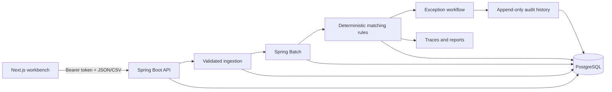

# ReconRiver

**Explainable payment reconciliation and settlement operations.**

[Live workbench](https://reconriver.vercel.app) · [API documentation](https://reconriver-api.onrender.com/docs) · [Synthetic datasets](https://huggingface.co/datasets/heybadrinath/reconriver-synthetic-reconciliation)

ReconRiver reconciles internal-ledger, payment-processor, and bank-settlement records through deterministic rules. Operations teams can trace every result to its source records and rule, investigate exceptions, record resolutions, review audit history, and export reconciliation reports.


## Capabilities

- Import internal, processor, and bank CSVs with validation, row quarantine, checksums, and duplicate-file detection.
- Run restartable, chunk-based reconciliation jobs backed by the Spring Batch job repository.
- Match ledger entries to processor activity, then processor settlement batches to bank credits.
- Preserve rule codes, explanations, monetary differences, and source identifiers with every result.
- Investigate, resolve, and reopen exceptions with append-only audit history.
- Inspect transaction traces, reconciliation summaries, job progress, and downloadable CSV reports.
- Load four deterministic scenario packs with committed ground truth for repeatable verification.

Public workspaces expire after 24 hours. Upload only synthetic data; the public service is not configured to handle personal, customer, or live financial records.

## Architecture



The backend is a Java 21 modular monolith built with Spring Boot, Spring Modulith, Spring Batch, Flyway, and PostgreSQL. It owns validation, matching, monetary policy, job state, exception transitions, and reporting. The Next.js application presents API-owned state and does not recalculate financial outcomes in the browser.

Key design decisions:

- Monetary values use `BigDecimal` and PostgreSQL `NUMERIC(19,4)` with explicit rounding rules.
- Ordered reconciliation rules always produce a stable rule code and human-readable explanation.
- PostgreSQL constraints protect import identity, active runs, work items, results, and immutable audit records.
- A bounded two-worker executor applies backpressure to asynchronous imports and reconciliation runs.
- Row locking serializes concurrent exception resolution and reopen operations.

See the [architecture overview](docs/architecture/OVERVIEW.md) and [architecture decisions](docs/decisions/).

## Repository layout

| Path                         | Purpose                                                                   |
| ---------------------------- | ------------------------------------------------------------------------- |
| `backend/reconciliation-api` | Spring Boot API, reconciliation engine, jobs, persistence, and migrations |
| `backend/dataset-generator`  | Deterministic Java scenario generator                                     |
| `frontend`                   | Next.js operator workbench                                                |
| `datasets`                   | Generated scenario packs, schemas, checksums, and dataset card            |
| `scripts`                    | Runtime, contract, and dataset verification utilities                     |
| `docs`                       | Architecture decisions and deployment runbooks                            |

## Quick start

Requirements:

- Java 21
- Docker with Compose
- Node.js 24
- pnpm 11.20

Start PostgreSQL and the API:

```bash
cp .env.example .env
docker compose up -d postgres

cd backend
./mvnw spring-boot:run -pl reconciliation-api
```

In a second terminal, start the frontend:

```bash
cd frontend
pnpm install --frozen-lockfile
NEXT_PUBLIC_API_URL=http://localhost:8080 pnpm dev
```

Open [http://localhost:3000](http://localhost:3000). Swagger UI is available at [http://localhost:8080/docs](http://localhost:8080/docs).

## Configuration

Local defaults are defined in [`.env.example`](.env.example). The main runtime variables are:

| Variable                      | Purpose                                   | Local default                                 |
| ----------------------------- | ----------------------------------------- | --------------------------------------------- |
| `DB_URL`                      | PostgreSQL JDBC URL                       | `jdbc:postgresql://localhost:5432/reconriver` |
| `DB_USERNAME` / `DB_PASSWORD` | Database credentials                      | Local Compose credentials                     |
| `DEMO_TOKEN_HASH_SECRET`      | HMAC secret used to hash workspace tokens | Local-only development value                  |
| `ALLOWED_ORIGINS`             | Exact browser origins accepted by CORS    | `http://localhost:3000`                       |
| `MAX_UPLOAD_BYTES`            | Per-file upload limit                     | `10485760`                                    |
| `MAX_IMPORT_ROWS`             | Maximum data rows per uploaded CSV        | `25000`                                       |
| `BATCH_CHUNK_SIZE`            | Spring Batch chunk size                   | `500`                                         |
| `DB_POOL_SIZE`                | Hikari maximum pool size                  | `3`                                           |
| `NEXT_PUBLIC_API_URL`         | API origin used by the frontend           | `http://localhost:8080`                       |

The `production` Spring profile rejects missing database credentials, local credential defaults, an unsafe token-hash secret, or an invalid CORS configuration. Never commit secrets or a concrete database endpoint.

## API and datasets

- OpenAPI document: [`frontend/openapi/openapi.json`](frontend/openapi/openapi.json)
- Generated frontend types: [`frontend/src/lib/api/schema.d.ts`](frontend/src/lib/api/schema.d.ts)
- Live Swagger UI: [reconriver-api.onrender.com/docs](https://reconriver-api.onrender.com/docs)
- Dataset card and generation guide: [`datasets/README.md`](datasets/README.md)
- Published dataset: [ReconRiver synthetic reconciliation scenarios](https://huggingface.co/datasets/heybadrinath/reconriver-synthetic-reconciliation)

The repository includes clean-settlement, mixed-exceptions, month-end-close, and failure-recovery packs. Each pack contains three source CSVs, exact expected results, a manifest, checksums, and a reproducible archive. Generated data is licensed under CC BY 4.0.

## Verification

Run the backend suite with Java 21:

```bash
cd backend
./mvnw verify
```

Run frontend quality and contract checks with Node.js 24:

```bash
cd frontend
pnpm install --frozen-lockfile
pnpm format:check
pnpm lint
pnpm typecheck
pnpm test
pnpm api:check
pnpm build
```

Verify dataset reproducibility and the repository-root container build:

```bash
./scripts/verify-datasets.sh
docker build --file backend/reconciliation-api/Dockerfile --tag reconriver-api .
```

The integration suite uses PostgreSQL Testcontainers to cover migrations, imports, exact ground-truth comparison, restart without duplicate output, competing runs, workspace isolation, exception transitions, audit history, and database locking. CI also checks OpenAPI drift, executable-JAR startup, non-root container execution, dataset checksums, and committed-secret patterns.

## Deployment

The public service uses:

- Vercel for the Next.js frontend.
- Render for the containerized Spring Boot API.
- Neon PostgreSQL for durable application and Spring Batch state.
- Hugging Face for the public synthetic dataset.

Deployment configuration and verification procedures are documented in [Render deployment](docs/deployment/RENDER.md) and [free-tier constraints](docs/deployment/FREE_TIER_NOTES.md). The API intentionally uses a direct Neon SSL endpoint with a three-connection application pool; it does not rely on Render's ephemeral filesystem for durable data.

## Security and data policy

- Workspace bearer tokens are high entropy, returned once, and stored only as keyed hashes.
- Every business query is scoped to a workspace; workspaces and their data expire after 24 hours.
- Uploads are restricted by media type, filename, byte size, row count, column count, and row width.
- Exported values that could be interpreted as spreadsheet formulas are neutralized.
- The deployed API exposes public health and info probes while keeping metrics and module internals unavailable.
- The public application accepts synthetic CSV data only. Do not upload real payment, banking, customer, or personal information.

Security concerns can be reported privately through the repository owner's GitHub profile. Do not include credentials or sensitive records in an issue.

## Operational constraints

- The public API can take several minutes to resume after idle periods on the current hosting plan.
- Public imports are limited to 10 MB and 25,000 rows per CSV.
- Reconciliation rules model a defined set of payment and settlement outcomes; they are not processor-specific accounting policy.
- Anonymous workspaces do not provide organization membership, roles, approval chains, or regulated retention controls.
- Multi-region availability, disaster recovery, private object storage, malware scanning, and compliance controls are outside the current deployment scope.

## Documentation

- [Architecture overview](docs/architecture/OVERVIEW.md)
- [Architecture decisions](docs/decisions/)
- [Render deployment](docs/deployment/RENDER.md)
- [Free-tier constraints](docs/deployment/FREE_TIER_NOTES.md)
- [Dataset card](datasets/README.md)

## License

Application source is available under the [MIT License](LICENSE). Generated datasets are available under the [Creative Commons Attribution 4.0 International License](https://creativecommons.org/licenses/by/4.0/).
