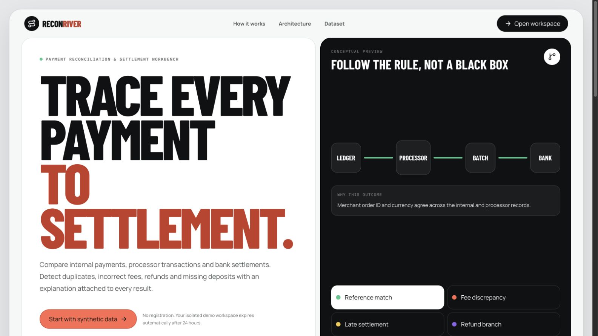
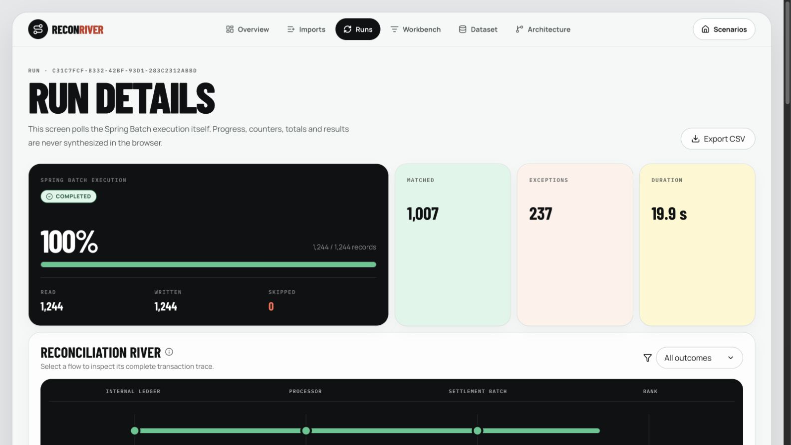
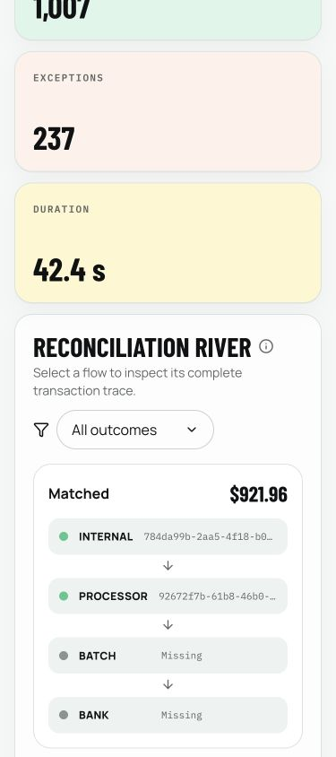
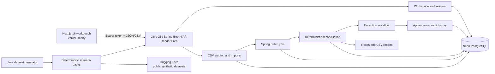

# ReconRiver

**Explainable payment reconciliation and settlement operations, built as a Java-first portfolio system.**

[Live workbench](https://reconriver.vercel.app) · [API documentation](https://reconriver-api.onrender.com/docs) · [Synthetic datasets](https://huggingface.co/datasets/heybadrinath/reconriver-synthetic-reconciliation) · [Source](https://github.com/heybadrinath/reconriver) · [Portfolio](https://ram-badrinath.vercel.app/)

ReconRiver turns synthetic internal-ledger, processor, and bank-settlement exports into deterministic reconciliation results. An operator can follow each result from source records to a named rule, investigate exceptions, resolve or reopen them, inspect the append-only audit history, and export a CSV report.

> The public site is a personal, non-commercial demonstration. Use synthetic data only. It is not production financial infrastructure, and its free backend can take time to wake after being idle.



## 60-second demo

Start an anonymous workspace, load **Mixed exceptions**, and let the API import its synthetic ledger, processor, and bank files. Run reconciliation and use the River to open one exception, compare its source records and named rule, resolve it with a note, then reopen it and inspect the append-only audit history. Finish by exporting the CSV report and opening the Architecture page to connect the visible workflow to Spring Batch restartability, deterministic money rules, PostgreSQL constraints, and the modular-monolith boundaries.

## Product flow

1. Start an anonymous 24-hour workspace. The raw bearer token is returned once; only its keyed hash is stored.
2. Load one of four deterministic scenario packs or upload three synthetic CSV files.
3. Spring Batch stages, validates, normalizes, and imports the rows into PostgreSQL. Invalid rows are quarantined with reasons.
4. A restartable reconciliation job applies ordered ledger-to-processor rules, then processor-batch-to-bank rules.
5. The Next.js workbench shows API-owned progress and outcomes through summaries, the Reconciliation River, result tables, transaction traces, and exception actions.
6. Resolve or reopen an exception, inspect the audit timeline, and download the run report.





## Architecture



The backend is a Spring Modulith modular monolith, not a collection of pretend microservices. Imports, reconciliation output, resolutions, and audit events benefit from local transactions, while tested package boundaries keep future extraction possible. PostgreSQL is the durable system of record; Render's local filesystem is not used for durable data. Stored scenarios are bundled from the same committed artifacts published to Hugging Face, so the public dataset is verifiable evidence rather than a runtime network dependency.

### Why these choices

- `BigDecimal`, declared rounding, and PostgreSQL `NUMERIC(19,4)` keep money comparisons deterministic.
- Spring Batch provides chunk transactions, a durable job repository, progress metadata, and restart semantics.
- Flyway V1–V9 and database constraints protect canonical imports, one active run per workspace, stable work identities, results, and append-only audit rows.
- The bounded two-worker application executor applies backpressure instead of creating an unbounded number of asynchronous tasks.
- The frontend renders API results and never recalculates financial match status.

## Verified live evidence

The following measurements were observed against the public Render API and Neon database on 2026-08-09. They are demonstration measurements on a constrained free instance, not throughput claims for a production payment system.

| Journey                                                    | Total results | Matched | Exceptions | Observed elapsed time |
| ---------------------------------------------------------- | ------------: | ------: | ---------: | --------------------: |
| Mixed exceptions                                           |         1,244 |   1,007 |        237 |                19.9 s |
| Month-end close, 10,000 canonical payments                 |        11,539 |  11,239 |        300 |          Not recorded |
| Controlled failure and recovery, 10,000 canonical payments |        11,369 |  10,813 |        556 |              264.65 s |

Result totals include both order-level and settlement-level work, so they can exceed the number of canonical payments.

The first Render deployment reached application readiness in 207 seconds. That is an initial deployment-startup observation; it is not presented as a measured wake time from Render's idle state.

Additional live operations evidence:

| Check                          | Observation                                                                                                                                                               |
| ------------------------------ | ------------------------------------------------------------------------------------------------------------------------------------------------------------------------- |
| Maximum public import boundary | A 25,000-row synthetic internal-ledger CSV imported 25,000/25,000 rows with 0 quarantined in 260 s                                                                        |
| Rolling service replacement    | The replacement started Spring in 210.494 s; the existing service remained available, and the same workspace retained 1,244 results plus its resolve/reopen audit entries |
| Genuine idle wake              | After 20m19.9s without public API activity, the UI showed its wake state and reached a real workspace by 266.5 s (4m26.5s) after the first user action                    |
| Final deployed mobile journey  | Run `200291e1-8569-472d-ad2a-f1a5204da843` completed with 1,244 results: 1,007 matched and 237 exceptions in 42.4 s                                                       |

No public downtime was observed during that rolling replacement. This is persistence and rollout evidence from one event, not a high-availability claim or a measurement of an idle-service cold start.

For the separate idle-wake check, the UI exposed a live `role="status"` message—**The backend is waking up. This can take several minutes...**—and disabled both start actions by +5.3 s. Render started the container at +5.057 s, logged Spring startup at +25.802 s, and reported the application started in 211.098 s (+226.501 s from the click). The browser still showed the wake state at +243.085 s and was on `/scenarios` with a real workspace by +266.512 s. Therefore 266.5 s is an observed upper bound for the end-to-end transition, not an exact response time.

The final deployed 375 × 844 mobile audit measured no horizontal document overflow, all 49 visible application-owned targets at 44 × 44 px or larger, a visible 301 px-wide vertical River, and no desktop River SVG. Axe recorded 29 passes, 0 violations, and 0 incomplete checks; the console recorded 0 warnings or errors; reduced-motion mode left 0 animated elements. Representative focus rings were visible, while natural sequential Tab order is not claimed as manually verified.

The public Hugging Face repository exposes all 16 scenario/file configurations in Dataset Viewer. The downloaded artifacts were checked against all 32 committed SHA-256 entries, and the committed generator reproduces the CSV, JSON, ZIP, and documentation artifacts byte for byte from seed `42` and fixed start date `2026-01-01`.

## Scenario packs

| Scenario           | Canonical payments | Purpose                                                                      |
| ------------------ | -----------------: | ---------------------------------------------------------------------------- |
| `clean-settlement` |                100 | Fully matched baseline                                                       |
| `mixed-exceptions` |              1,000 | Missing, duplicate, currency, amount, fee, refund, and settlement exceptions |
| `month-end-close`  |             10,000 | Larger deterministic month-end journey                                       |
| `failure-recovery` |             10,000 | Controlled five-chunk failure followed by a bodyless restart                 |

Each pack includes three source CSVs, exact expected reconciliation output, a manifest, checksums, a downloadable archive, and a scenario README. The data is synthetic and published under CC BY 4.0; the application source is MIT licensed.

## Quality gates

- Maven `verify` on Java 21: 32 tests — 16 API tests, including seven PostgreSQL Testcontainers journeys, plus 16 generator tests — with Spotless formatting and Spring Modulith boundary verification.
- Frontend: Prettier, ESLint, TypeScript, 35 Vitest unit/accessibility tests across 12 files, and a Next.js production build.
- Browser journey: two Playwright projects (desktop Chromium and mobile Chromium) against real API results, covering scenario load, imports, reconciliation, resolve, reopen, audit history, CSV export, and axe checks.
- Final production mobile audit: WCAG 2.0/2.1/2.2 A/AA axe scan, 44 px target sizing, overflow, reduced motion, River layout, representative focus rings, and console output.
- Contract drift: running Spring OpenAPI versus the committed document, then committed OpenAPI versus generated TypeScript.
- Packaging: executable JAR and repository-root Docker build, runtime smoke journey under `-Xmx320m`, and non-root container execution as UID `10001`.
- Data publication: schema validation, row counts, reproducibility, manifest hashes, archives, and all 16 Hugging Face Viewer configurations.
- CI: Java/JAR, frontend, root-context container, dataset reproducibility, and secret-scanning jobs.

These gates prove the implemented demonstration and its deterministic fixtures. They do not establish regulatory compliance, high availability, or production-scale performance.

## Run locally

Requirements: Java 21, Docker, Node.js 24, and pnpm 11.20.

```bash
cp .env.example .env
docker compose up -d postgres

cd backend
./mvnw spring-boot:run -pl reconciliation-api
```

In a second terminal:

```bash
cd frontend
pnpm install --frozen-lockfile
NEXT_PUBLIC_API_URL=http://localhost:8080 pnpm dev
```

Open `http://localhost:3000`. Local defaults are documented in [`.env.example`](.env.example); never commit real database credentials or token secrets.

### Verify the repository

```bash
cd backend && ./mvnw verify
cd ../frontend && pnpm format:check && pnpm lint && pnpm typecheck && pnpm test && pnpm api:check && pnpm build
cd .. && docker build --file backend/reconciliation-api/Dockerfile --tag reconriver-api .
```

Dataset reproducibility additionally requires `check-jsonschema`:

```bash
./scripts/verify-datasets.sh
```

## Public deployment shape and limits

- **Frontend:** Vercel Hobby, for this personal non-commercial portfolio only.
- **API:** Render Free in Frankfurt, one web process, 512 MB class, 320 MB JVM heap, two bounded batch workers, no keep-alive traffic.
- **Database:** direct Neon PostgreSQL SSL endpoint, Hikari maximum pool size `3`, `minimumIdle=0`.
- **Dataset:** public Hugging Face repository containing synthetic artifacts only.
- **Retention:** workspaces expire after 24 hours and scheduled cleanup deletes their data.
- **Uploads:** CSV only, 10 MB and 25,000 data rows maximum; formula-like report cells are neutralized.
- **Availability:** the backend scales down when idle, the Render filesystem is ephemeral, Neon can scale to zero, and monthly free allowances can make the demo temporarily unavailable.

The live Render service was created through Render's official API using the checked-in `render.yaml` values. It is not Blueprint-linked, and automatic deployment is disabled so a tested commit can be promoted deliberately. Database credentials and the generated token-hash secret exist only in Render.

The maximum 25,000-row public import boundary and genuine idle-to-workspace wake are both verified above. Free-service wake time varies; the single observation is not a service-level guarantee.

## Documentation

- [Architecture overview](docs/architecture/OVERVIEW.md)
- [Design system](docs/architecture/DESIGN_SYSTEM.md)
- [Interview guide and honest trade-offs](docs/INTERVIEW_GUIDE.md)
- [Render deployment and verification](docs/deployment/RENDER.md)
- [Free-tier constraints](docs/deployment/FREE_TIER_NOTES.md)
- [Dataset card](datasets/README.md)
- [Design QA](design-qa.md)

## Responsible use

ReconRiver deliberately excludes real payment data, real customer data, fuzzy auto-acceptance, claims of financial compliance, and claims of production scale. A real deployment would still need organization identity, least-privilege roles, approval workflows, private object storage and malware scanning, tamper-evident retention, backup and disaster-recovery tests, SLOs, paging, privacy review, and processor-specific rule governance.

## License

Application source: [MIT](LICENSE). Synthetic datasets: [CC BY 4.0](datasets/README.md#licence).
