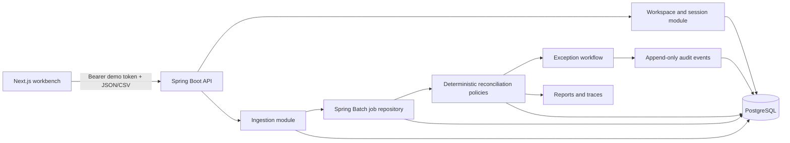

# Architecture overview

ReconRiver is a Java-first modular monolith. Next.js presents the operator experience, but the Spring Boot API owns file validation, imports, monetary rules, matching, job state, exception transitions, audit history, and reporting.

## End-to-end flow

1. The browser requests a 24-hour demo session. Spring Boot creates an isolated workspace, stores only an HMAC hash of the high-entropy token, and returns the raw token once.
2. The visitor loads a Java-generated scenario or uploads synthetic CSV files. The request verifies the file name, media type, headers, limits, and checksum while staging raw rows in PostgreSQL. A restartable Spring Batch job then validates source fields and persists normalized records.
3. Invalid staged rows are quarantined with row numbers and actionable reasons. Workspace, source type, and checksum identify a canonical import. A byte-identical attempt against a finished import is recorded as a duplicate and skipped; an active attempt reuses that import, while a failed import is requeued.
4. The reconciliation job applies ordered ledger-to-processor rules, then aggregates processor net amounts into settlement batches and compares them with bank credits.
5. Every result stores an outcome, rule code, explanation, related records, monetary fields, timestamps, and resolution state.
6. The frontend polls real job repository state and renders summaries, results, the Reconciliation River, and the equivalent table from API responses.
7. Resolve and reopen operations lock the selected result row with `SELECT … FOR UPDATE`, validate the current state, and create append-only audit events in the same transactional use case.

## Module boundary intent

- `workspace`: demo session lifecycle and workspace isolation.
- `dataset`: stored scenario catalog, downloads, and workspace loading.
- `ingestion`: CSV staging, source-specific persisted records, row quarantine, and file idempotency.
- `reconciliation`: run lifecycle, deterministic policies, results, and progress.
- `investigation`: exception state transitions and operator notes.
- `reporting`: CSV export and transaction traces.
- `audit`: append-only event history.
- `shared`: Problem Details, configuration, SQL time conversion, Batch infrastructure, and named lifecycle events. Money policy remains inside `reconciliation`.

The Spring Modulith architecture test verifies cycles and illegal dependencies in the declared module graph. Business queries explicitly scope access by workspace, while PostgreSQL foreign keys require a valid workspace. Partial and unique constraints protect canonical files, one active run, stable work identities, and result identities; database triggers make audit history append-only. Cross-table workspace ownership is not enforced by composite foreign keys, so the workspace predicate remains a required application invariant.
